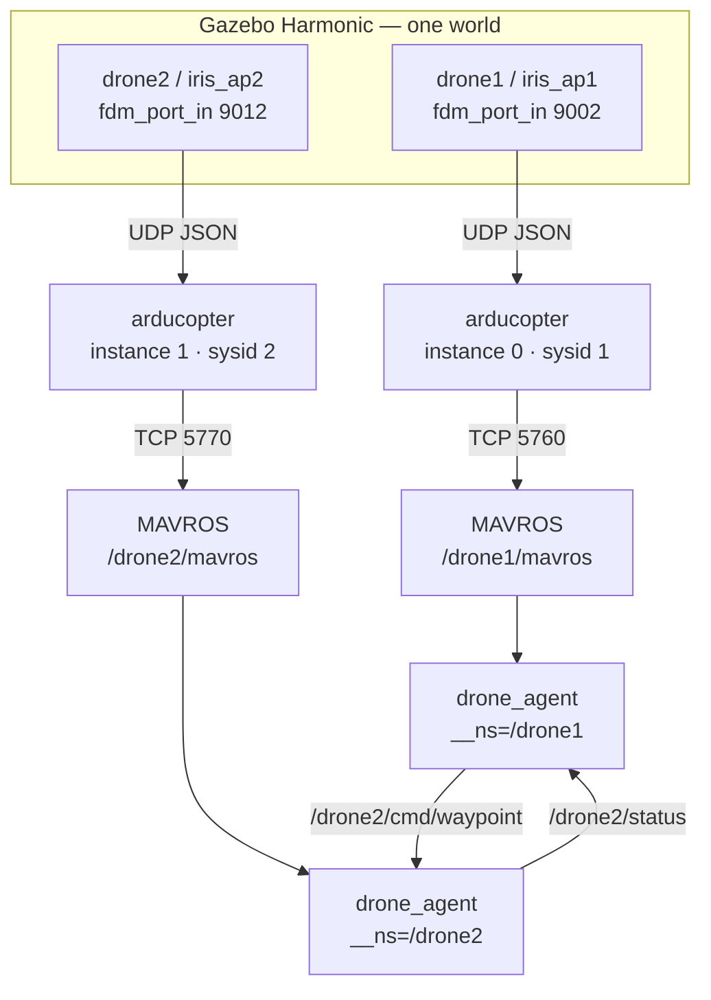
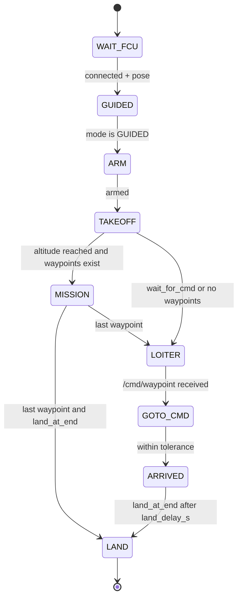

# Multi-drone simulation

`ap-multi` runs two or more ArduCopter vehicles in **one Gazebo world**. Each
vehicle has its own SITL process, its own MAVROS namespace, and its own mission
agent. The demo is also a communication test: drone 1 flies a square, then sends
drone 2 a waypoint; drone 2 waits in a GUIDED hold until it receives it.

!!! info "What this page covers"
    The topology, the namespace/port scheme, how the world is generated, how to
    launch the demo, the agent state machine, the inter-drone topics, and the
    known limitations.

## Topology



There are three independent channels per drone:

1. **Physics**: the Gazebo model sends JSON/UDP to ArduPilot SITL on its
   `fdm_port_in` port.
2. **MAVLink**: SITL exposes TCP `5760 + 10·(K−1)`, and MAVROS connects to it.
3. **ROS 2**: MAVROS and the agent share a namespace, so the same agent code
   produces `/droneK/...` topics for every vehicle.

## Ports and IDs

| Drone | Gazebo FDM port | SITL instance | MAVLink `sysid` | SITL TCP | MAVROS namespace |
|---|---|---|---|---|---|
| 1 | 9002 | 0 | 1 | 5760 | `/drone1` |
| 2 | 9012 | 1 | 2 | 5770 | `/drone2` |
| K | `9002 + 10(K−1)` | `K−1` | `K` | `5760 + 10(K−1)` | `/droneK` |

## Why namespaces

You do not write a separate mission node for each drone. You write one node that
uses **relative** ROS names:

```python
'mavros/state'
'mavros/local_position/pose'
'mavros/setpoint_position/local'
'cmd/waypoint'
'status'
```

Then you start the same node once per drone:

```bash
python3 docs/multi_missoes/drone_agent.py --ros-args -r __ns:=/drone1
python3 docs/multi_missoes/drone_agent.py --ros-args -r __ns:=/drone2
```

ROS 2 resolves every relative name under the node namespace. MAVROS is launched
with the matching namespace:

```bash
ros2 launch mavros apm.launch ... namespace:=drone1
ros2 launch mavros apm.launch ... namespace:=drone2
```

The result is two complete topic trees:

```text
/drone1/mavros/state
/drone1/mavros/local_position/pose
/drone1/mavros/setpoint_position/local
/drone1/status
/drone1/cmd/waypoint

/drone2/mavros/state
/drone2/mavros/local_position/pose
/drone2/mavros/setpoint_position/local
/drone2/status
/drone2/cmd/waypoint
```

!!! warning "Namespace trap"
    Use `namespace:=drone1`, not `namespace:=drone1/mavros`. The second form
    produces `/drone1/mavros/mavros/...`.

## The world is generated, not spawned

`ap-multi` does not call `ros_gz_sim create` at runtime. Runtime spawning caused
timeouts and made Gazebo and the launch process depend on a shared `/tmp`. Instead
the script generates the world before starting anything:

1. Copy the upstream `iris_with_ardupilot` model for each drone.
2. Rename each copy (`iris_ap1`, `iris_ap2`, …) and change its `fdm_port_in`
   (`9002`, `9012`, …).
3. Copy `iris_runway.sdf`, rename the world, and insert all drone models at
   `x = (K−1) · SPACING`.
4. Remove the Gazebo sensors/render plugin. The demo has no cameras, and the
   render system only costs CPU.
5. Write `.multi_sim/worlds/multi_iris_runway.sdf`.

The generated files live under `.multi_sim/` and are not committed.

## Launch it

Inside the container (rebuild the image first if the scripts changed):

```bash
cd ~/git_projects/atlas_ws/docker
xhost +local:docker
docker compose run --rm dev ap-multi demo
```

If the image predates the scripts, run the current file directly:

```bash
docker compose run --rm dev bash /home/ros/atlas_ws/docker/scripts/ap-multi demo
```

| Command | What it does |
|---|---|
| `ap-multi demo` | Gazebo + 2 SITLs + 2 MAVROS + 2 agents. The default demo. |
| `ap-multi demo 3` | Same with 3 drones (drone 3 only waits; see limitations). |
| `ap-multi` | Gazebo + 2 SITLs + 2 MAVROS, no agents. |
| `ap-multi 3` | Same with 3 drones. |
| `ap-multi gen 2` | Only generate the world and models. |
| `ap-multi down` | Kill the tmux session and all simulation processes. |

Environment variables:

| Variable | Default | Effect |
|---|---|---|
| `GUI=1` | off | Open the Gazebo window (`gz sim -g`). |
| `SPEEDUP` | `1` | SITL speed multiplier. |
| `SPACING` | `3` | Distance between drones on the X axis, in metres. |
| `WIPE=1` | off | Delete saved SITL parameters (`-w`). |
| `GCS=1` | off | Forward MAVLink to QGroundControl on UDP 14550. Not verified. |
| `NO_TMUX=1` | off | Run in the background; logs go to `.multi_sim/logs/`. |
| `SETTLE` | `20` | Seconds between Gazebo → SITL and SITL → MAVROS. Use 40 on a slow PC. |

The tmux session has three windows: `sim` (Gazebo + SITLs), `mavros` (both MAVROS
instances), and `agents` (one `drone_agent.py` per drone). With `GUI=1` there is a
fourth `gui` window. Switch windows with `Ctrl-b n` / `Ctrl-b p`; detach with
`Ctrl-b d`; reattach with `tmux attach -t multi`.

## What happens in the demo

| Time | Event |
|---|---|
| T+0 | Gazebo starts with both drones already in the world. |
| T+`SETTLE` | Both SITL processes start. |
| A few seconds later | Both MAVROS instances start (`SETTLE + 8` in the tmux path). |
| After another short delay | The agents start (`SETTLE + 12` in the tmux path; `NO_TMUX` waits another `SETTLE`). Drone 2 is told to wait; drone 1 gets the square. |
| Drone 1 takeoff | GUIDED → arm → takeoff to 5 m. |
| Drone 1 mission | `(0,0,5)` → `(10,0,5)` → `(10,10,5)` → `(0,10,5)`. |
| Drone 1 at WP 2 | Sends `(3,12,8)` to `/drone2/cmd/waypoint` and repeats at 1 Hz until drone 2 confirms. |
| Drone 2 | Takes off to 8 m, holds position, receives the waypoint, flies to `(3,12,8)`, reports `ARRIVED`, waits 5 s, lands. |
| Drone 1 end | Lands after the last waypoint. |

The script starts the waiting drone first, but the 1 Hz handshake makes the start
order irrelevant.

## Flight logic

`drone_agent.py` is a state machine:



Key details:

- **GUIDED is the backbone.** The "loiter" is not ArduCopter LOITER mode. It is
  GUIDED with a constant position setpoint.
- **Stream rates are requested automatically.** MAVROS connects but does not
  publish `local_position/pose` until ArduPilot is asked to send the messages.
  The agent calls `mavros/set_stream_rate` while waiting for the FCU.
- **Sensor QoS is required.** `local_position/pose` is BEST_EFFORT; the agent
  subscribes with `qos_profile_sensor_data`.
- **Takeoff uses `CommandTOL`.** The agent then switches to position setpoints.
- **Arming retries.** A failed arm (EKF/GPS not ready) is retried until it works.

## Communication contract

| Topic | Type | Direction | Meaning |
|---|---|---|---|
| `/droneK/cmd/waypoint` | `geometry_msgs/PoseStamped` | peer → drone K | Target in the world frame (ENU). |
| `/droneK/status` | `std_msgs/String` | drone K → peers | Current phase, published at 1 Hz. |

Status values include `LOITER`, `MISSION wp=2/4`, `GOTO_CMD`, `ARRIVED`, and
`LAND`. The sender repeats the waypoint at 1 Hz until it sees `GOTO_CMD` or
`ARRIVED` in the peer's status.

Test the communication without flying the full demo:

```bash
ros2 topic pub -t 3 -r 1 /drone2/cmd/waypoint geometry_msgs/msg/PoseStamped \
  "{pose: {position: {x: 8.0, y: 0.0, z: 8.0}}}"
ros2 topic echo /drone2/status
```

## Frames and coordinates

In this setup, every SITL starts from the same GPS origin, so each drone's MAVROS
local frame coincides with the Gazebo world frame. A drone spawned at `x=3`
appears at `pose_local=(3.0, 0.0)`. That is why `origin_x` and `origin_y` are
`0.0` and the waypoints are plain world coordinates.

If you give each drone a different home, subtract its home position:

```text
local = world − home
```

The `frame_id` fields (`map` for setpoints, `world` for peer messages) are
informational; the numbers are already in the same world frame.

## Collision avoidance

Drone K flies at `5 + 3·(K−1)` metres:

| Drone | Altitude |
|---|---|
| 1 | 5 m |
| 2 | 8 m |
| 3 | 11 m |

This is deliberately simple. Drone 1's square passes through the ground point
where drone 2 holds position; at the same altitude, the two collided in testing.
The separation is not a general collision-avoidance system.

## Manual debugging

One terminal per piece, all inside the same container:

```bash
# 1. Generate only
ap-multi gen 2

# 2. Gazebo (server)
gz sim -s -r -v3 /home/ros/atlas_ws/.multi_sim/worlds/multi_iris_runway.sdf

# 3. One SITL per drone (run each in its own directory)
cd /tmp && arducopter --model json --speedup 1 --slave 0 \
  --sim-address=127.0.0.1 --instance 0 --sysid 1 \
  --defaults "$ARDUPILOT_HOME"/Tools/autotest/default_params/copter.parm,"$ARDUPILOT_HOME"/Tools/autotest/default_params/gazebo-iris.parm

# 4. One MAVROS per drone
ros2 launch mavros apm.launch fcu_url:=tcp://127.0.0.1:5760 tgt_system:=1 namespace:=drone1
ros2 launch mavros apm.launch fcu_url:=tcp://127.0.0.1:5770 tgt_system:=2 namespace:=drone2

# 5. Agents
python3 docs/multi_missoes/drone_agent.py --ros-args -r __ns:=/drone2 \
  -p takeoff_alt:=8.0 -p wait_for_cmd:=true
python3 docs/multi_missoes/drone_agent.py --ros-args -r __ns:=/drone1 \
  -p takeoff_alt:=5.0 \
  -p waypoints:="0,0,5;10,0,5;10,10,5;0,10,5" \
  -p peer_ns:=/drone2 -p notify_at_wp:=2 -p notify_wp:="3,12,8"
```

Useful checks:

```bash
ros2 topic list | grep mavros
ros2 topic echo /drone1/mavros/state --once
ros2 topic echo /drone2/status
ros2 service call /drone1/mavros/set_stream_rate mavros_msgs/srv/StreamRate \
  "{stream_id: 0, message_rate: 10, on_off: true}"
```

## Common errors

| Symptom | Cause | Fix |
|---|---|---|
| `arducopter` exits and prints `Options:` | `--use_sim_time` only exists when ArduPilot is built with DDS. | Use `ap-multi` (it does not pass the option), or build with `--enable-DDS`. |
| Gazebo: `Error finding file [/tmp/....yaml]` | Gazebo and the launch process are in different containers, so `/tmp` is not shared. | Run everything in the same container. |
| `Found additional publishers on /stats`, nothing works | Two Gazebo servers are running. | `ap-multi down`; remove leftover dev containers. |
| `create: request timed out` | The world was not ready, or the spawn service is not reachable. | `ap-multi` pre-generates the world; if it persists, `export GZ_IP=127.0.0.1`. |
| `package 'micro_ros_agent' not found` | `multiagent.launch.py` requires micro-ROS. | Do not use that launch; `ap-multi` does not need it. |
| Agent stuck in `WAIT_FCU`, `connected: true` | No stream rates, so no `local_position/pose`. | The agent requests them; manually call `set_stream_rate` if needed. |
| `InvalidTopicName: '//drone2/cmd/waypoint'` | `peer_ns:=/drone2` with a leading slash. | The agent strips the slash; update if you use an old version. |
| Topics at `/drone1/mavros/mavros/...` | `namespace:=drone1/mavros` in `apm.launch`. | Use `namespace:=drone1`. |
| MAVROS aborts: `egm96-5.pgm` not readable | Missing GeographicLib geoid dataset. | Run `install_geographiclib_datasets.sh`; the image should include it. |
| Parameter timeouts in MAVROS | Two MAVROS instances connected to the same SITL port. | One MAVROS per drone; `ap-multi down` and retry. |
| One drone falls and disarms | Both drones at the same altitude; the square crosses the hold point. | Separate altitudes (`5 + 3·(K−1)`). |
| `controller has reset`, `Time jump detected` in a loop | The PC is overloaded and SITL loses sync with Gazebo. | `SETTLE=40`, close the GUI, fewer drones, `WIPE=1`. |
| `bash: ap-multi: Permission denied` | Script is not executable, or the image is old. | `bash …/ap-multi demo` or rebuild the image. |
| `'arducopter' is not in PATH` | SITL was not built. | `atlas-build --packages-select ardupilot_sitl` or `ap-check`. |
| SITL stays in `Waiting for connection` | Normal until MAVROS connects; start order matters. | Start Gazebo first, then SITL, then MAVROS. |

## Limitations

- `ap-multi` is a **two-drone demo**, not a swarm scheduler. With `N > 2`, only
  drone 1 sends a waypoint to drone 2; the other drones hold position and, because
  `wait_for_cmd=true`, never receive an `ARRIVED` and therefore never land.
- The demo has **no real perception or collision avoidance**. Altitude separation
  is a manual rule.
- `GCS=1` and the Gazebo GUI path were not fully verified in the `atlas-sim:humble`
  container according to the source checklist.
- Everything runs in one container. That avoids `/tmp` and ROS discovery problems,
  but there is no process isolation.
- The world generator expects the current upstream `iris_with_ardupilot` model
  strings. If upstream changes the model name or `fdm_port_in`, `ap-multi` stops
  with a clear error instead of silently producing a broken world.

## Source files

- `docker/scripts/ap-multi` — world generation, SITL/MAVROS/agent orchestration.
- `docs/multi_missoes/drone_agent.py` — the per-drone state machine.
- `docs/multi_missoes/README.md` — the original Portuguese notes and test log.
- `docker/scripts/ap-help` — the `multi` section of the quick manual.

## Related

- [Control & Mission Planning](index.md)
- [Home](../index.md)
